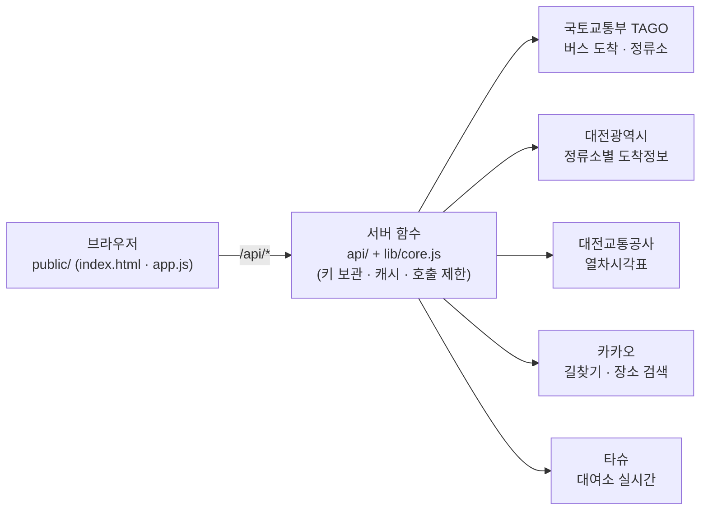

# 통학길 비교 · 대전 🚇

> **대기·환승 시간까지 포함한 '진짜 도착 시각'으로 통학 경로를 비교하는 웹사이트**
> DSC공유대학 모빌리티리빙랩 1조 **C.A.W**

지도 앱은 보통 이동 시간만 보여 줍니다. 하지만 통학생에게 실제로 문제인 건 **배차 간격, 노선 우회, 대기, 환승 대기**로 늘어나는 전체 이동시간입니다 (팀 설문 n=28: 배차간격 68% · 노선 우회 46% · 대기 29% · 환승 대기 18%).
이 프로젝트는 버스·지하철·공영자전거(타슈)·택시를 조합한 경로마다 **지금 출발하면 몇 시에 도착하는지**와 **예상 요금**을 실시간 데이터로 계산해 비교합니다.

**첫 구간:** 충남대 공과대학 3호관 → 대전역 (월평역 환승)

---

## 비교하는 경로

| 경로 | 구성 | 특징 |
|---|---|---|
| **A** 기준 | 도보 → 108번 버스 → 월평역 → 지하철 1호선 | 버스+지하철 환승 요금 1,550원 |
| **B** | 택시 | 가장 빠르지만 요금이 높음 |
| **C** | 타슈(공영자전거)로 대전역까지 | 요금 0원, 가장 오래 걸림 |
| **D** | 타슈 → 월평역 → 지하철 | 버스 대기를 없앤 복합경로 |
| **E** | 택시 → 월평역 → 지하철 | 짧은 택시 + 지하철 복합경로 |

**A와 같은 요금(1,550원) 안에서 가장 빨리 도착하는 경로**에 '추천'이 붙습니다.

> 발표 기준 예시 (평일 14:11 출발): A 15:03 도착 · D 14:53 도착 → 같은 요금으로 **10분 단축**
> ※ 열차시각표 연결 후 월평→대전역 소요시간이 18분이 아닌 19분으로 확인되어, 사이트는 시각표 값으로 계산합니다.

## 주요 기능

- **경로 비교**: 지금 출발 기준 A~E 경로의 단계별 시각(도보 · 대기 · 승차 · 환승)과 도착 시각, 요금
- **실시간 반영**
  - 108번 버스 도착 예정 → "지금 가면 탑승 / 놓침" 판단
  - 대전도시철도 열차시각표 (평일·휴일 구분) → 월평역 열차 대기·소요시간
  - 출발지 근처 타슈 대여소의 자전거 수
  - 카카오 길찾기 기반 택시 시간·요금
- **주변 정류장 실시간**: 출발지 근처 정류장의 도착 예정 버스 (대전 어디서든)
- **지도**: 클릭으로 출발·도착 지정, 장소 검색, 내 위치

## 구조



API 키는 서버에만 있고 브라우저로 전달되지 않습니다. 외부 패키지 없이 Node.js 내장 기능만 사용합니다.

## 폴더

| 폴더 | 내용 | 실행 |
|---|---|---|
| [`cnu-route-web/`](cnu-route-web/) | **실시간 웹사이트** (최종판) | Node.js 18+ · `npm start` |
| [`cnu-route-site/`](cnu-route-site/) | API 없는 계산기 (출발 시각 입력 → A~E 도착·요금) | `index.html` 열기 |
| [`prototypes/`](prototypes/) | 설문용 프로토타입, 오프라인 계산기 | 브라우저로 열기 |

```
cnu-route-web/
├─ api/          서버 함수 (stops · arrivals · arrivals-dj · subway · drive · search · tashu · config · health)
├─ lib/core.js   외부 API 호출 · 응답 정리 · 오류 해석 · 캐시 · 호출 제한
├─ public/       화면 (index.html · app.js · style.css · health.html)
│  └─ scenario.js  계산 기준값 (정류장 · 도보 · 타슈 시간 등) ← 실측하면 여기만 수정
└─ server.js     로컬 실행 서버
```

## 실행하기

```bash
git clone https://github.com/KangSeungWan/Mobility-LivingLab-Transfer.git
cd Mobility-LivingLab-Transfer/cnu-route-web
cp .env.example .env      # 발급받은 키 입력
npm start                 # → http://localhost:3000
```

- 설치할 패키지는 없습니다 (`npm install` 불필요).
- `.env` 없이 실행하면 **예시 데이터 모드**로 화면만 확인할 수 있습니다.
- `http://localhost:3000/health.html`에서 API별 연결 상태를 점검할 수 있습니다.

| 환경변수 | 발급처 | 용도 |
|---|---|---|
| `DATA_GO_KR_KEY` | [공공데이터포털](https://www.data.go.kr) | TAGO 버스도착·정류소, 대전시 도착정보, 대전교통공사 열차시각표 |
| `KAKAO_REST_KEY` | [Kakao Developers](https://developers.kakao.com) | 장소 검색, 택시 시간·요금 |
| `KAKAO_JS_KEY` | Kakao Developers (선택) | 카카오 지도 표시 (없으면 OpenStreetMap) |
| `TASHU_KEY` | 타슈 Open API | 대여소 실시간 자전거 수 |

> ⚠️ `.env`는 절대 커밋하지 마세요. `.gitignore`로 제외되어 있습니다.

배포(Vercel)와 상세 설정은 [`cnu-route-web/README.md`](cnu-route-web/README.md)를 참고하세요.

## 진행 상황

- [x] 문제 정의 · 설문 (n=28)
- [x] 설문용 프로토타입, API 없는 계산기
- [x] 실시간 웹사이트: 버스·정류장·택시·장소 검색·타슈 API 연결
- [x] 108번 월평역 방면 정류장 확정
- [x] 대전교통공사 열차시각표 연결 (평일·휴일)
- [x] 배포 대비: 대전 범위 제한 · 호출 제한 · CDN 캐시
- [ ] 카카오 지도, Vercel 배포
- [ ] 프로토타입 20명 설문 → 복합경로(D·E) 전환율 30% 이상이면 개발 계속
- [ ] 도보·타슈·버스 승차시간 실측 반영
- [ ] 대전 전역 확대: 지도에서 위치를 찍으면 가까운 환승 거점을 자동 선택해 복합경로 추천

## 팀 C.A.W

DSC공유대학 모빌리티리빙랩 1조 · 충남대학교

## 데이터 출처와 이용 조건

이 저장소에는 API 키와 외부 데이터 원본이 포함되어 있지 않습니다. 실행 시 각 기관의 API를 호출하며, 이용 조건은 각 제공처를 따릅니다.

- 국토교통부 TAGO 버스도착정보·버스정류소정보, 대전광역시 정류소별 도착정보, 대전교통공사 열차시각표 — [공공데이터포털](https://www.data.go.kr)
- 카카오 로컬·카카오모빌리티 길찾기·카카오맵 — [Kakao Developers](https://developers.kakao.com) 이용약관
- 타슈 대여소 정보 — 대전광역시 공영자전거 타슈 Open API
- 지도 (카카오 키가 없을 때) — © [OpenStreetMap](https://www.openstreetmap.org/copyright) contributors (ODbL), [Leaflet](https://leafletjs.com) (BSD-2-Clause)
- 글꼴 — Pretendard, Noto Sans KR (SIL Open Font License)

화면의 시간·요금은 실시간 데이터와 가정값(도보·타슈·역내 이동)을 조합한 **추정치**입니다.

## 라이선스

코드: [MIT](LICENSE) · 외부 데이터·서비스·글꼴은 각 제공처의 조건을 따릅니다.
